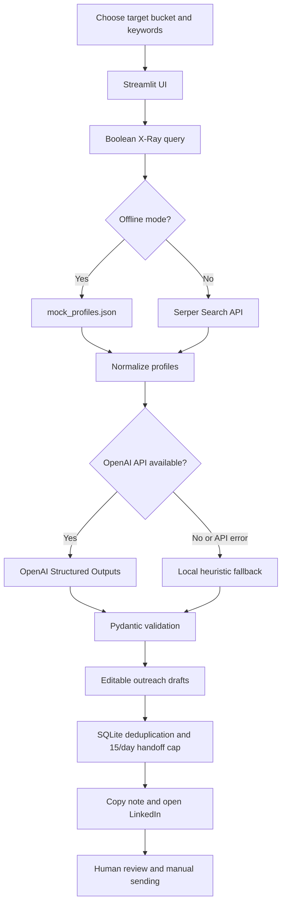

# LinkedIn Learner Discovery & Outreach Agent

A Streamlit and Python application that discovers publicly indexed learner profiles, classifies career personas, scores profile relevance, and prepares personalized, human-reviewed outreach drafts.

The project supports offline mock profiles, live public search through Serper, OpenAI Structured Outputs when API credits are available, and a local heuristic fallback.

> **Demo safety:** Mock LinkedIn URLs are fictional placeholders. They must not be contacted.

## Architecture



## Features

- Discover fictional demo profiles offline or publicly indexed profiles through Serper.
- Build Boolean X-Ray search queries using target persona and keywords.
- Classify profiles as `Fresher`, `1-2_YOE`, or `Career_Switcher`.
- Generate relevance scores from 1 to 10 with a short explanation.
- Use OpenAI Structured Outputs with Pydantic when API access and credits are available.
- Fall back to local heuristic scoring when the OpenAI API is unavailable.
- Generate editable LinkedIn connection notes under 300 characters.
- Generate editable follow-up messages under 100 words.
- Track handed-off profiles in SQLite and enforce a maximum of 15 handoffs per day.
- Copy a message and open a LinkedIn profile or search page for human review.

## AI Scoring and Fallback

The application attempts to use OpenAI Structured Outputs to produce a validated payload containing:

- `detected_persona`
- `relevance_score`
- `reasoning`
- `connection_note`
- `follow_up_dm`
- `generator`

If the OpenAI API is unavailable, unconfigured, or out of credits, the application uses its local heuristic fallback.

**Important:** A successful API-key connection does not guarantee available API credits. The generator label in the dashboard identifies which scoring method produced the result.

Heuristic relevance scores are estimates based on profile text. They are not verified assessments of a person's skills or suitability.

## Safety and Responsible Use

- No LinkedIn credentials, cookies, authenticated scraping, or automatic message sending.
- Live discovery uses a search provider to retrieve publicly indexed results.
- Review profile information and all message drafts before deciding whether to contact someone.
- Mock profile URLs are fictional placeholders and must not be contacted.
- SQLite tracks previous handoffs and enforces a daily handoff limit of 15.
- The handoff limit is an application safeguard, not a guarantee against account restrictions.
- Follow LinkedIn's terms, search-provider requirements, and applicable privacy rules.

## Setup (Windows PowerShell)

1. Install Python 3.10 or newer.
2. Open the project folder in VS Code.
3. Select **Terminal → New Terminal**.
4. Create a virtual environment:

   ```powershell
   py -m venv .venv
   ```

5. Install dependencies:

   ```powershell
   .\.venv\Scripts\python.exe -m pip install -r requirements.txt
   ```

6. Optional: configure API credentials as described below.
7. Start the application:

   ```powershell
   .\.venv\Scripts\python.exe -m streamlit run app.py
   ```

8. Open the local URL displayed in the terminal, usually `http://localhost:8501`.

For a no-API demo, keep **Offline demo mode** enabled.

## Optional API Configuration

Create a local `.env` file using `.env.example` as a template.

Example:

```env
SERPER_API_KEY=
OPENAI_API_KEY=
OPENAI_MODEL=gpt-4o-mini
```

- Set `SERPER_API_KEY` to enable live public search.
- Set `OPENAI_API_KEY` and `OPENAI_MODEL` to enable OpenAI scoring.
- OpenAI API usage may require available API credits.
- Restart the application after changing environment variables.

Never commit `.env` or share API keys. External search and AI providers may process submitted data under their own policies.

## Project Files

- `app.py` — Streamlit interface and workflow.
- `src/discovery.py` — Boolean query construction and profile discovery.
- `src/scoring.py` — OpenAI structured scoring and local heuristic fallback.
- `src/storage.py` — SQLite handoff tracking, duplicate detection, and daily limit.
- `src/dispatch.py` — Copy-note and open-profile handoff.
- `data/mock_profiles.json` — Fictional demo profiles.
- `sample_output.json` — Illustrative scoring payloads.
- `requirements.txt` — Python dependencies.
- `.env.example` — Example environment configuration.

Sample outputs are illustrative and may not exactly match live AI or heuristic results.